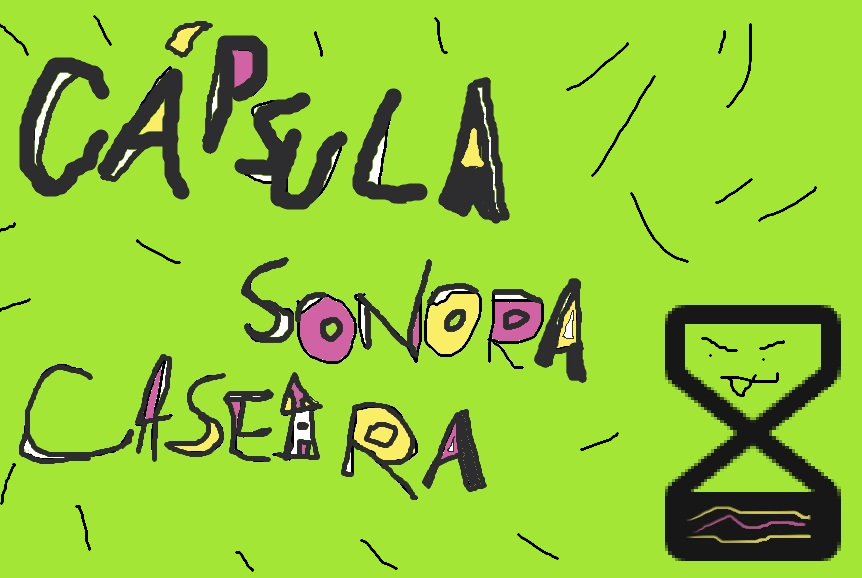

<div align="center">



# 🎧 Cápsula Sonora

### Seu histórico do Last.fm transformado em uma cápsula do tempo musical

*Rankings, ritmos, descobertas e conexões entre artistas: tudo o que você ouviu, contado em um painel interativo.*

<br />


<br />

[▶️ Ver o vídeo](#-a-cápsula-em-1-minuto) · [✨ Recursos](#-o-que-tem-dentro-da-cápsula) · [🚀 Rodar localmente](#-rodar-localmente) · [☁️ Publicar grátis](#️-publicar-de-graça) · [🔒 Privacidade](#-privacidade)

</div>

---

## ▶️ A cápsula em 1 minuto

<!--
  COMO INCLUIR O VÍDEO:
  1. No GitHub, clique em editar este README (ícone de lápis).
  2. Arraste o arquivo .mp4 (até 10 MB no plano gratuito) para dentro do editor, nesta linha.
  3. O GitHub gera um link "https://github.com/user-attachments/assets/..." — deixe-o sozinho na linha.
  4. Apague este comentário e salve.
-->

COLE_AQUI_O_LINK_DO_VIDEO

---

## 🎵 Como funciona

```text
   🎧 Você ouve música          📡 Last.fm registra         🗄️ Servidor sincroniza        📊 Cápsula Sonora
  ───────────────────  ──▶  ───────────────────  ──▶  ───────────────────  ──▶  ───────────────────
   Spotify, Deezer,          cada faixa vira um          scrobbles + durações         análises direto no
   YouTube Music...          "scrobble"                  + gêneros no MySQL           navegador (DuckDB)
```

1. **Informe seu usuário do Last.fm** na tela ou direto no link: `https://seu-app/?user=seu_usuario`.
2. **Na primeira visita**, o servidor baixa seu histórico completo. Quem tem muitos scrobbles espera alguns minutos.
3. **Daí em diante**, só as músicas novas são buscadas, automaticamente.

> 💡 Não precisa criar conta nem chave de API. Basta ter um perfil **público** no Last.fm.

---

## ✨ O que tem dentro da cápsula

<table>
<tr>
<td width="50%" valign="top">

### 📊 Dashboard
- **KPIs com hover:** tempo ouvido, reproduções, artistas e músicas únicas, dia recorde e maior sequência, com variação contra o período anterior
- **Seus favoritos:** top 5, 10 ou 20 artistas, músicas e álbuns, com capas
- **Evolução do tempo** por dia, semana, mês ou ano
- **Ranking em movimento** dos cinco artistas líderes
- **Acumulado da jornada**

</td>
<td width="50%" valign="top">

### 🕐 Ritmos e descobertas
- **Dia da semana × hora:** mapa de calor de quando você ouve
- **Períodos do dia:** madrugada, manhã, tarde e noite
- **Galáxia da sua escuta:** artistas em órbita, por intensidade
- **Novos artistas** e **assinatura de descoberta**
- **Artistas mais fiéis** ao longo dos anos
- **Fluxo da sua escuta:** quem costuma tocar depois de quem

</td>
</tr>
<tr>
<td width="50%" valign="top">

### 🖼️ Last.fm one page
- Mosaico de artistas e álbuns principais com fotos e capas
- Faixas mais ouvidas
- Exportação da **página inteira em imagem**

</td>
<td width="50%" valign="top">

### 💊 Gerar Cápsula
- Card visual pronto para compartilhar
- Opção de **remover o logo**
- **Filtros globais:** calendário com vários meses, atalhos de período e artista e álbum conectados entre si

</td>
</tr>
</table>

---

## 🧱 Por baixo do capô

| Camada | Tecnologia | Papel |
|---|---|---|
| 🎨 Interface | React · TypeScript · Vite · Tailwind | painel, filtros e páginas |
| 📈 Gráficos | Recharts | visualizações interativas |
| 🦆 Análise | DuckDB-WASM | consultas SQL **no próprio navegador** |
| ⚙️ API | Node.js · Express | sincronização e entrega dos dados |
| 🗄️ Banco | MySQL | histórico por usuário + cache de durações e gêneros |
| 🎼 Dados | Last.fm · MusicBrainz | scrobbles, capas e fotos |

```text
capsula_sonora/
├── src/                  🎨 frontend (React)
│   ├── components/       gráficos, cards, filtros, one page
│   ├── lib/              DuckDB, formatação, imagens, usuário dinâmico
│   └── store/            estado global
├── server/               ⚙️ backend (Express)
│   ├── src/              API, sincronização e integração Last.fm
│   └── schema.sql        tabelas (criadas automaticamente)
├── .env.example          🔑 modelo de variáveis
└── package.json
```

---

## 🚀 Rodar localmente

**Você vai precisar de:** Node.js 20+ e MySQL 8 (ou MariaDB).

```bash
# 1. Clonar
git clone https://github.com/gabrriela07/capsula_sonora_caseira.git
cd capsula_sonora_caseira

# 2. Instalar dependências (site + servidor)
npm install
npm install --prefix server

# 3. Configurar variáveis
cp .env.example server/.env
```

Preencha o `server/.env` com sua chave do Last.fm ([crie aqui](https://www.last.fm/api/account/create)) e os dados do MySQL. Depois:

```bash
# 4. Um único comando sobe a API e o site juntos
npm run dev
```

Abra **http://localhost:5173/?user=seu_usuario** e pronto. 🎉

> No terminal, `[API]` aparece em amarelo e `[SITE]` em ciano. Se um cair, o outro para junto.

---

## ☁️ Publicar de graça

| Serviço | Para quê | Plano |
|---|---|---|
| [Render](https://render.com) | site + API | Free |
| [Aiven](https://aiven.io) | MySQL na nuvem | Free |

**No Render, crie um *Web Service* ligado ao repositório:**

| Campo | Valor |
|---|---|
| Build command | `npm install && npm run build && npm install --prefix server` |
| Start command | `npm run server` |

**Em *Environment*, cadastre:**

| Variável | | Descrição |
|---|:---:|---|
| `LASTFM_API_KEY` | ✅ | chave da API do Last.fm |
| `MYSQL_HOST` · `MYSQL_PORT` · `MYSQL_USER` · `MYSQL_PASSWORD` | ✅ | conexão do banco |
| `MYSQL_DATABASE` | ✅ | nome do banco (no Aiven: `defaultdb`) |
| `MYSQL_SSL` | ✅ | `true` no Aiven |
| `VITE_LASTFM_API_KEY` | ⭐ | capas e fotos no painel |
| `LASTFM_USER` | ➖ | usuário aberto quando o link não informa outro |
| `ALLOWED_USERS` | ➖ | limita a usuários específicos: `ana,joao` |
| `APP_PASSWORD` | ➖ | pede senha para abrir o site |
| `SYNC_INTERVAL_MINUTES` | ➖ | intervalo de sincronização (padrão `60`) |

<sub>✅ obrigatória · ⭐ recomendada · ➖ opcional. Não cadastre `PORT`: o Render define sozinho.</sub>

> 😴 No plano gratuito, o Render dorme após 15 minutos sem acesso. O primeiro acesso depois disso leva cerca de 1 minuto e já sincroniza as músicas novas.

---

## 🔌 API

Todas as rotas aceitam `?user=nome`. Sem ele, usam o `LASTFM_USER`.

| Rota | O que faz |
|---|---|
| `GET /api/config` | usuário padrão da instalação |
| `GET /api/status` | totais e progresso; inicia a primeira carga de um usuário novo |
| `POST /api/sync` | força uma sincronização |
| `GET /api/history.csv` | histórico completo do usuário |

```bash
# sincronização manual (dentro de server/)
npm run sync -- seu_usuario
```

---

## 🔒 Privacidade

- A cápsula mostra apenas dados que **já são públicos** no seu perfil do Last.fm.
- Qualquer pessoa com o link pode abrir a cápsula de um usuário público. Para limitar, use `ALLOWED_USERS` ou `APP_PASSWORD`.
- Variáveis `VITE_` ficam visíveis no navegador. **Nunca** coloque senhas ou o *shared secret* do Last.fm nelas.
- O arquivo `.env` nunca vai para o GitHub.

---

<div align="center">

### 🎶 Viva a música! 

<br />

Feito com ❤️ e muitos scrobbles por **[/gabrriela07](https://github.com/gabrriela07)**

<sub>Se a cápsula te fez sorrir, deixe uma ⭐ no repositório!</sub>

</div>
